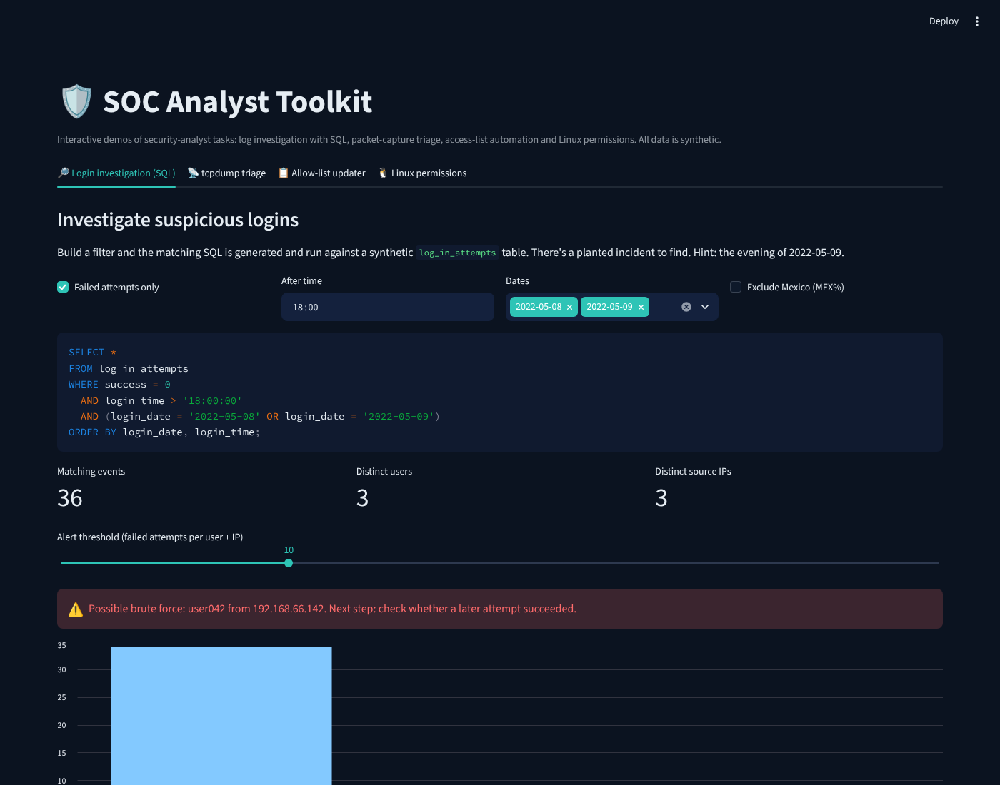
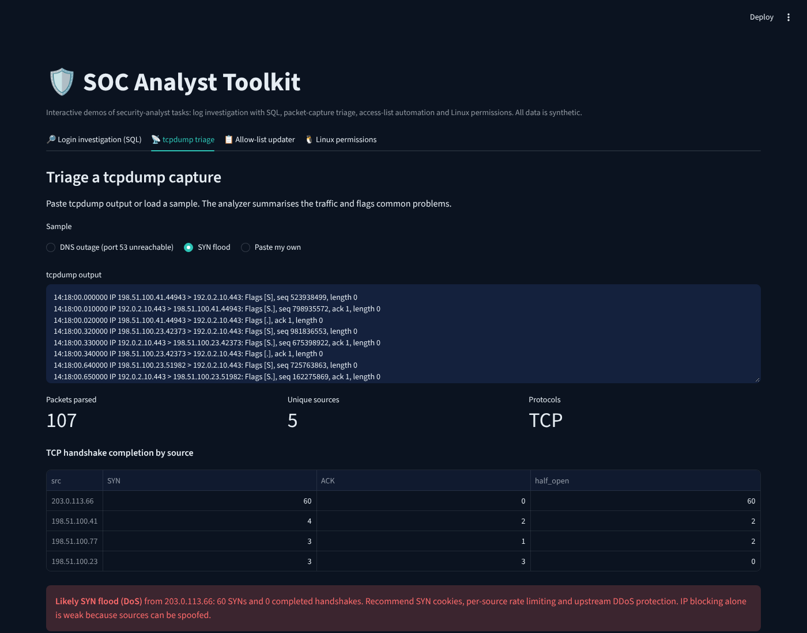

# 🛡️ SOC Analyst Toolkit

An interactive Streamlit app that turns my Google Cybersecurity Certificate projects into working tools:

| Tab | What it shows | Related portfolio project |
|---|---|---|
| 🔎 **Login investigation (SQL)** | Build filters and see the generated SQL run live against a synthetic log database. Includes brute-force detection and a planted incident to find. | SQL: Filtering Data for Security Investigations |
| 📡 **tcpdump triage** | Paste a tcpdump capture. The app parses it, flags ICMP port-unreachable errors (DNS outage) and SYN floods (half-open handshake ratio). | DNS Network Traffic Analysis · SYN Flood DoS Incident |
| 📋 **Allow-list updater** | Removes revoked IPs from an allow list, with input validation and a download of the updated file. | Python: Automating an IP Allow-List Update |
| 🐧 **Linux permissions** | `chmod` calculator (symbolic ↔ octal) with least-privilege warnings. | Linux: Securing File Permissions |




## Run locally

```bash
pip install -r requirements.txt
streamlit run streamlit_app.py
```

## Deploy (free)

1. Push this folder to a public GitHub repository.
2. Go to <https://share.streamlit.io>, choose **New app**, and select the repo, the branch and `streamlit_app.py`.
3. Add the live link to your GitHub README, your CV, LinkedIn and your website.

## Notes

- All data is **synthetic**: the login database is generated with a fixed seed, and the captures use documentation IP ranges.
- The custom SQL box only accepts a single `SELECT` statement against an in-memory database.
- Ideas to extend it: a phishing-URL feature checker, a CVSS score calculator, a MITRE ATT&CK lookup for detections, and an upload option for real `.pcap` files (using `scapy`).
